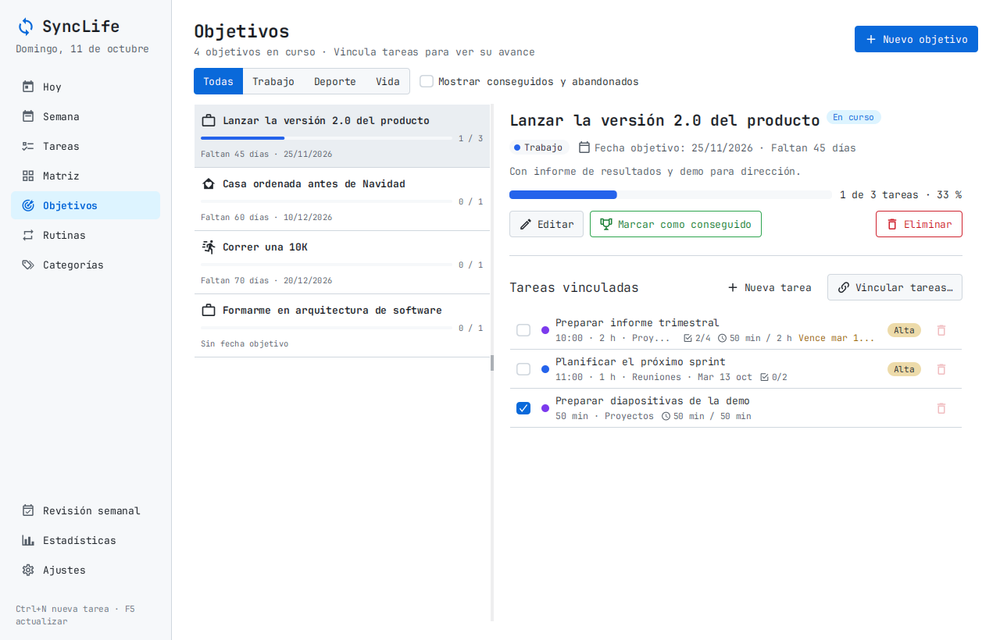
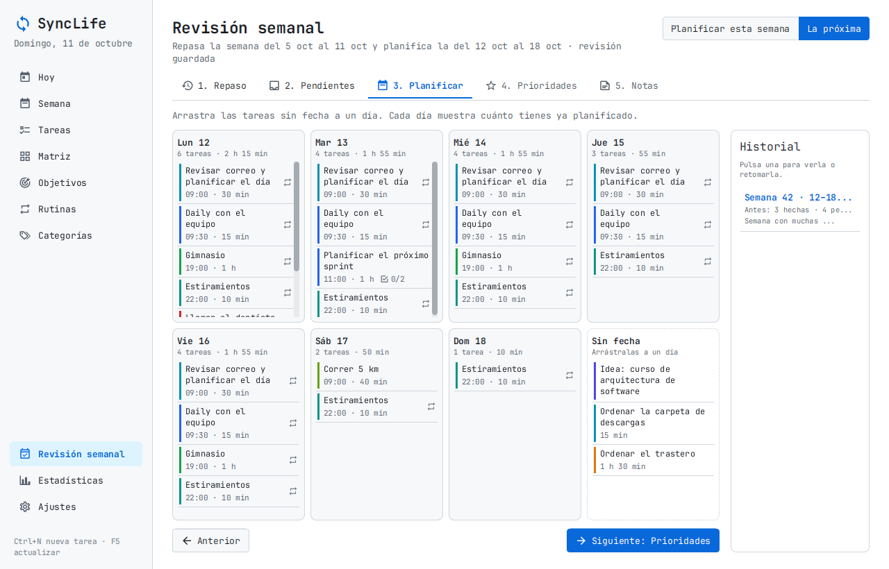
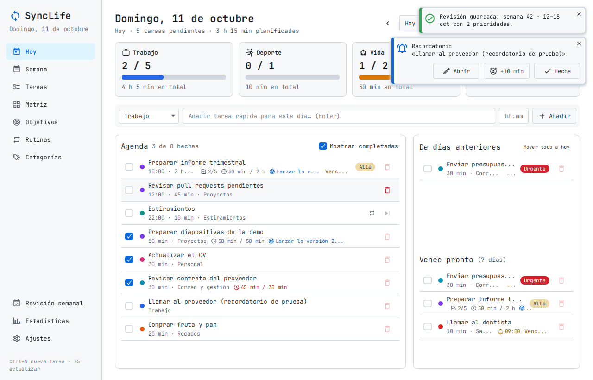
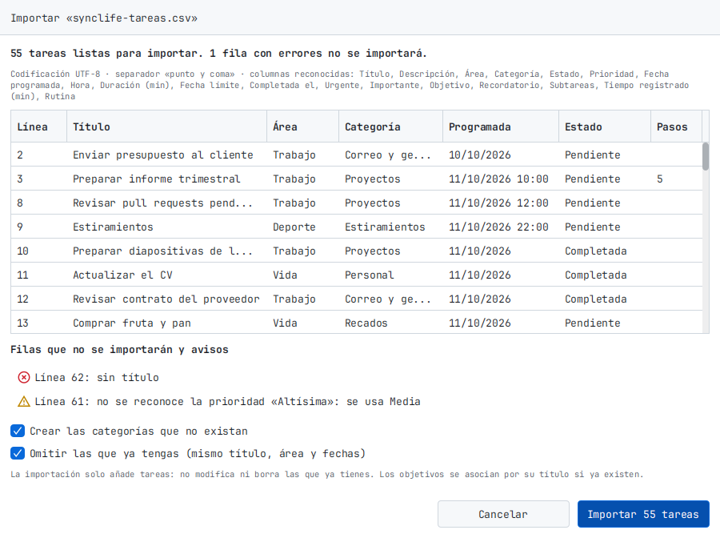

# SyncLife

Gestor de tareas y rutinas de escritorio, centrado en el **trabajo** y con espacio para el **deporte** y la **vida personal**.
Hecho con **Java 21 + JavaFX 21**, persistencia en **SQLite** mediante **Hibernate 7**, y distribuido como
**instalador de Windows**, **paquete para Ubuntu/Debian** (los dos con Java incluido) o **un único JAR ejecutable**.

## Instalar

Descarga la última versión desde **[Releases](https://github.com/alexwarrior1991/sync-life/releases)**:

| Fichero | Para |
|---|---|
| `SyncLife-X.Y.Z.msi` | **Windows**: instalador. No hace falta tener Java. Crea acceso en el menú Inicio y en el escritorio. |
| `SyncLife-X.Y.Z-windows-portable.zip` | Windows sin instalar: descomprime y abre `SyncLife\SyncLife.exe`. |
| `synclife_X.Y.Z_amd64.deb` | **Ubuntu/Debian**: `sudo apt install ./synclife_X.Y.Z_amd64.deb` (se desinstala con `sudo apt remove synclife`). |
| `SyncLife-X.Y.Z.jar` | Cualquier sistema con Java 21 o superior: doble clic o `java -jar SyncLife-X.Y.Z.jar`. |

> **Aviso de Windows (SmartScreen).** El instalador no está firmado con un certificado de pago, así que la primera vez
> Windows puede mostrar «Windows protegió su PC». Pulsa **Más información → Ejecutar de todas formas**.

Para **actualizar**, instala el `.msi` nuevo encima: sustituye la versión anterior. Tus datos no se tocan
(están en tu carpeta de usuario, no en la de la aplicación), y tampoco se borran al desinstalar.

## Ejecutar desde el código

Requisitos: un JDK **21 o superior** (funciona también con Java 25).

```bash
# Compilar, pasar los tests y generar el JAR ejecutable
./mvnw clean package          # en Windows: mvnw.cmd clean package

# Ejecutar
java -jar target/SyncLife-all.jar
```

En IntelliJ: ejecuta la clase `com.alejandro.synclife.Launcher` (no `SyncLifeApp`).

Los datos se guardan en `~/.synclife/` (en Windows `C:\Users\<usuario>\.synclife\`):
`synclife.db` (SQLite), `settings.properties` y `logs/`. Se puede cambiar con `-Dsynclife.home=/otra/ruta`
o la variable de entorno `SYNCLIFE_HOME`.

> En **Ajustes → Cargar datos de ejemplo** tienes tareas y rutinas de muestra para probarla.

| Hoy (con un Pomodoro en marcha) | Matriz de Eisenhower |
|---|---|
|  |  |
| **Editor con lista de comprobación** | **Estadísticas: estimado frente a real** |
|  |  |
| **Objetivos** | **Revisión semanal: planificar la semana** |
|  |  |
| **Semana con sus prioridades** | **Tema oscuro** |
|  |  |
| **Recordatorio** | **Importar tareas desde CSV** |
|  |  |

## Pantallas

| Pantalla | Para qué sirve |
|---|---|
| **Hoy** | Agenda del día ordenada por hora, progreso por área, alta rápida, tareas arrastradas de días anteriores y fechas límite próximas. |
| **Semana** | Siete columnas (L–D). Arrastra tareas entre días o desde "Sin programar" para planificar. Filtro por área. Muestra las **prioridades** elegidas en la revisión semanal. |
| **Tareas** | Todas las tareas en una tabla con búsqueda (sin distinguir tildes) y filtros por área, categoría, estado, prioridad y fecha. Columna **Tiempo** con lo estimado y lo real. Selección múltiple (Ctrl/Mayús + clic) para **eliminar varias a la vez**, botón **Borrar completadas** y **Exportar** (a CSV, con los filtros aplicados). |
| **Matriz** | **Matriz de Eisenhower**: las tareas abiertas en cuatro cuadrantes (hacer ya, planificar, delegar, eliminar) según sean urgentes y/o importantes. Arrastra entre cuadrantes para reclasificar; las nuevas esperan en "Sin clasificar". Por defecto muestra el trabajo. |
| **Objetivos** | **Objetivos a largo plazo** por área (p. ej. "Correr una 10K") con fecha objetivo. Vincula tareas (de cualquier área) y mira su avance: completadas frente al total. Se marcan como conseguidos o abandonados. |
| **Rutinas** | Hábitos recurrentes (p. ej. "Gimnasio L-X-V 19:00"). Cada rutina genera automáticamente la tarea de cada día, con su **aviso** si lo tiene. |
| **Categorías** | Categorías propias dentro de cada área (Trabajo, Deporte, Vida), con color. Se pueden archivar. |
| **Revisión semanal** | Asistente guiado en 5 pasos para cerrar una semana y planificar la siguiente: repaso, pendientes, planificar días, hasta **3 prioridades** y notas. Guarda un historial. |
| **Estadísticas** | Completadas por área y por día, **tiempo real registrado**, **precisión de las estimaciones** (tabla "estimado frente a real") y cumplimiento de rutinas. |
| **Ajustes** | Tema claro/oscuro, días de antelación de las rutinas, duración del Pomodoro, **notificaciones y bandeja**, copia de seguridad, **exportar/importar CSV**, **borrar todos los datos** y carpeta de datos. |

Atajos: **Ctrl+N** nueva tarea · **Ctrl+1** Hoy · **Ctrl+2** Semana · **Ctrl+3** Tareas · **Ctrl+4** Matriz · **Ctrl+5** Objetivos · **Ctrl+6** Rutinas · **Ctrl+7** Categorías · **Ctrl+8** Revisión semanal · **Ctrl+9** Estadísticas · **Ctrl+0** Ajustes · **F5** actualizar · **Supr** eliminar la tarea seleccionada · doble clic para editar · clic derecho para más acciones.

### Lista de comprobación

En el editor de una tarea, **Lista de comprobación**: escribe un paso y pulsa Enter. Cada paso se marca, se edita,
se reordena (flechas o Alt+↑/↓) y se quita. Las listas muestran el avance (☑ 2/5). Se guarda con la tarea.

### Pomodoro y tiempo real

Clic derecho sobre una tarea → **Iniciar pomodoro** (o el botón *Pomodoro* del editor). La tarjeta de la barra lateral
muestra la cuenta atrás (también en el título de la ventana) y permite pausar, terminar o saltar el descanso.
Cada enfoque terminado se guarda como **tiempo real** de la tarea; si lo terminas antes, se guarda lo hecho (desde 1 minuto).
También puedes **apuntar tiempo a mano** desde *Registro* en el editor. Las listas muestran un reloj con
"50 min / 1 h" (en rojo si te pasas más de un 10 % de lo estimado) y Estadísticas compara lo estimado con lo real.
Duraciones (25/5/15 min, descanso largo cada 4) y sonido se cambian en Ajustes.

### Matriz de Eisenhower

Cada tarea puede marcarse como **urgente** y/o **importante**, independientemente de su prioridad, desde la Matriz
(arrastrando), el editor (campo *Matriz*) o el clic derecho → *Matriz*. Las tareas generadas por rutinas no se clasifican.

### Objetivos

En **Objetivos**, «Nuevo objetivo» (título, área, fecha objetivo opcional). Después, «Nueva tarea» crea una tarea ya
vinculada y «Vincular tareas…» elige entre las que tienes abiertas. También se elige el objetivo en el editor de
cualquier tarea (campo *Objetivo*), y las listas lo muestran junto a la tarea. Borrar un objetivo conserva sus tareas.

### Revisión semanal

De lunes a miércoles propone planificar la semana en curso; de jueves a domingo, la siguiente (se puede cambiar).
1. **Repaso** de la semana anterior: completadas, pendientes, tiempo registrado, rutinas y objetivos.
2. **Pendientes**: pásalas al lunes, quítales la fecha, márcalas como hechas o cancélalas (una a una o todas).
3. **Planificar**: arrastra las tareas sin fecha a un día; cada día muestra su carga.
4. **Prioridades**: hasta tres tareas para la semana; aparecen en la vista **Semana**.
5. **Notas** y «Guardar revisión». Puedes volver a una revisión desde el historial y actualizarla.

### Recordatorios y bandeja del sistema

En el editor de una tarea con fecha, **Recordatorio**: a la hora de la tarea, 5/10/15/30 min, 1 h, 2 h o 1 día antes,
o a una hora concreta (sin hora de inicio se cuenta desde las 09:00). Cada rutina tiene su **Aviso** y lo hereda cada
tarea que genera. Las tareas con aviso pendiente muestran una campana con la hora.

Cuando llega la hora aparece un aviso en la ventana con **Abrir**, **+10 min** (posponer) y **Hecha**, y suena (se
puede quitar en Ajustes). Si la ventana está oculta o minimizada, además sale una **notificación del sistema**.
Un aviso solo suena una vez; los que vencieron con SyncLife cerrada (hace más de 2 h) se resumen en un único aviso
con «Ver Hoy», y si mueves una tarea de día su aviso se mueve con ella.

Al **cerrar la ventana, SyncLife sigue en la bandeja** (junto al reloj) para que los avisos y el pomodoro sigan
funcionando: haz clic en el icono para volver y usa **Salir** en su menú para cerrarla del todo. Se desactiva en
Ajustes → Notificaciones, donde también se elige el aviso por defecto de las tareas nuevas. Si abres SyncLife otra
vez mientras ya está abierta, se muestra la ventana existente en lugar de abrir otra.

### Exportar e importar (CSV)

**Ajustes → Datos → Exportar tareas (CSV)** guarda todas las tareas en un fichero que abren Excel y LibreOffice
(UTF-8, separado por `;`). En **Tareas**, «Exportar» guarda solo las que muestran los filtros.

**Importar CSV…** lee ese formato o una hoja hecha a mano: basta una columna **Título**; el resto (Área, Categoría,
Estado, Prioridad, Fecha programada, Hora, Duración, Fecha límite, Urgente, Importante, Objetivo, Recordatorio,
Subtareas…) es opcional y la cabecera se reconoce sin importar mayúsculas ni tildes. Acepta fechas `2026-10-12` o
`12/10/2026`, separadores `;`, `,` o tabulador, y ficheros guardados por Excel en Windows. Antes de importar se
muestra una **vista previa** con lo que se va a crear y los errores por línea. La importación **solo añade** tareas;
con «Omitir las que ya tengas» reimportar el mismo fichero no duplica nada.

### Empezar de cero

**Ajustes → Datos → Borrar todos los datos…** deja SyncLife como recién instalada: borra tareas, rutinas,
objetivos y revisiones semanales, y vuelven las categorías de serie. Hay que escribir `BORRAR` para confirmar.
Antes de borrar se guarda una copia completa en la carpeta `copias` de la carpeta de datos; para recuperarla,
cierra SyncLife (también desde la bandeja) y pon esa copia en lugar de `synclife.db`. Los ajustes se conservan.

Para borrarlo absolutamente todo, ajustes incluidos: cierra SyncLife (en la bandeja → «Salir») y borra la
carpeta de datos (`C:\Users\<usuario>\.synclife`). Se vuelve a crear vacía al abrirla.

Para **eliminar** una tarea: la papelera al final de cada fila, el botón «Eliminar» del editor o la tecla Supr.
Las tareas que genera una rutina no se eliminan (volverían a aparecer): en su lugar se **omiten** (icono ⏭ o Supr).

## Arquitectura (MVC por capas)

```
src/main/java/com/alejandro/synclife/
├── Launcher.java            punto de entrada del JAR (no extiende Application)
├── SyncLifeApp.java         aplicación JavaFX
├── AppContext.java          raíz de composición: crea Hibernate, DAOs y servicios
├── config/                  rutas de datos, ajustes de usuario, logging, instancia única
├── persistence/             HibernateUtil, migraciones Flyway, copia de seguridad, converters
├── model/                   MODELO: entidades JPA (Task, Category, Routine, Subtask, TimeEntry) y enums
├── dao/                     consultas HQL (reciben la Session; sin estado)
├── service/                 lógica de negocio y transacciones (también recordatorios y CSV)
├── io/csv/                  lector y escritor de CSV (RFC 4180)
├── controller/              CONTROLADORES: uno por vista FXML
└── ui/                      navegación, celdas, controles propios, Pomodoro, avisos, bandeja, hilo de BD (FxAsync)
src/main/resources/
├── hibernate.cfg.xml
├── db/migration/            esquema SQL versionado (Flyway)
└── com/alejandro/synclife/  VISTAS: view/*.fxml, css/app.css, images/
```

- **Vista** (FXML + CSS) → **Controlador** (solo llama a servicios) → **Servicio** (transacción) → **DAO** (HQL) → SQLite.
- Todo el acceso a la base de datos se hace en **un único hilo** (`ui/FxAsync`), fuera del hilo de JavaFX: la interfaz no se bloquea y SQLite nunca recibe dos escrituras a la vez.

### Modelo de datos

- **Area** (enum fijo): `TRABAJO`, `DEPORTE`, `VIDA`.
- **Category**: nombre, color y área. Personalizable. Se puede archivar.
- **Task**: título, descripción, área, categoría (opcional), estado, prioridad, día programado, hora, duración estimada, fecha límite, fecha de completado, marcas **urgente/importante** (vacías = sin clasificar) y recordatorio (cuándo avisar y cuándo se avisó). Si la generó una rutina, apunta a ella.
- **Subtask**: un paso de la lista de comprobación de una tarea (texto, hecho, orden).
- **TimeEntry**: tiempo real dedicado a una tarea (inicio, fin, minutos efectivos y origen: Pomodoro o manual).
- **Goal**: objetivo con título, descripción, área, fecha objetivo y estado (en curso, conseguido, abandonado). Las tareas apuntan a él (`goal_id`, opcional).
- **WeeklyReview** / **WeeklyPriority**: una revisión por semana planificada (su lunes), con notas, una foto de cómo terminó la anterior y hasta tres tareas prioritarias.
- **Routine**: nombre, área, categoría, días de la semana (máscara de bits), hora, duración, prioridad, aviso (minutos antes), vigencia (desde/hasta) y si está activa.

Subtareas y registros de tiempo se borran con su tarea (`ON DELETE CASCADE`). Para no cargar listas enteras en la
interfaz, la tarea trae calculados (`@Formula`) cuántos pasos tiene, cuántos están hechos y los minutos registrados.

Las **rutinas generan sus tareas** desde hoy hasta el horizonte configurado (14 días por defecto), nunca para días pasados y sin duplicados.
Una tarea de rutina no se borra ni se cambia de día: se puede **"Omitir"**. Al editar una rutina se regeneran sus tareas pendientes y se conservan las completadas, omitidas, en progreso o con tiempo registrado.

### Decisiones técnicas

- **Esquema con Flyway, no con `hbm2ddl`**: el dialecto SQLite de Hibernate no genera claves foráneas ni índices únicos compuestos, así que el esquema está en `db/migration/*.sql` y Hibernate solo lo usa (`hbm2ddl.auto=none`).
  Para cambiar el modelo: añade `V9__descripcion.sql` con el `ALTER TABLE` correspondiente y actualiza la entidad
  (en SQLite, una columna nueva `NOT NULL` necesita valor por defecto y una con `REFERENCES` debe admitir NULL).
- **Fechas como texto ISO** (`2026-10-12`, `19:00`) mediante `AttributeConverter`, para que no dependan de la zona horaria.
- **Sin `module-info.java`**: la aplicación se ejecuta en classpath para que el JAR único funcione sin configuración. El aviso `Unsupported JavaFX configuration: classes were loaded from 'unnamed module'` es esperado e inofensivo.
- **Bandeja del sistema con AWT** (`SystemTray`): JavaFX no tiene una propia. Todo lo de AWT va por su hilo y lo de JavaFX por el suyo; si el escritorio no tiene bandeja (algunos Linux), SyncLife se cierra al cerrar la ventana como siempre.
- **Instancia única**: un bloqueo de fichero en la carpeta de datos más un socket local, porque con la ventana en la bandeja sería fácil abrir una segunda copia escribiendo en la misma base de datos.
- **JAR multiplataforma**: el `pom.xml` incluye `javafx-graphics` con clasificadores `win` y `linux`. Para añadir macOS, añade también los clasificadores `mac` y `mac-aarch64`.

## Tests

```bash
./mvnw test
```

Incluye tests unitarios (días de la semana, calendario de rutinas, ciclo Pomodoro con instantes simulados, cuadrantes,
converters, formatos, ajustes, lector/escritor CSV, instancia única) y de integración contra un SQLite real en un directorio
temporal: migraciones, claves foráneas y borrados en cascada, almacenamiento de fechas, servicios de tareas, listas de
comprobación, registro de tiempo, matriz, estadísticas, objetivos, revisión semanal, recordatorios, exportar/importar
CSV, borrar todos los datos, categorías y rutinas.

GitHub Actions (`.github/workflows/ci.yml`) pasa los tests en Linux con Java 21 y en Windows con Java 25, y en Linux
ejecuta también la prueba de humo de la interfaz y guarda las capturas como artefacto.

Prueba de humo de la interfaz completa (recorre todas las pantallas, lanza un recordatorio, reimporta un CSV, borra todos los datos al final y guarda capturas):

```bash
java -Dsynclife.home=/tmp/synclife-prueba -Dsynclife.smoke=true -Dsynclife.smoke.shots=/tmp/capturas -jar target/SyncLife-all.jar
```

## Publicar una versión

```bash
git tag v1.2.0
git push --tags
```

La etiqueta lanza `.github/workflows/release.yml`: compila con esa versión, pasa los tests y la prueba de humo,
genera con `jpackage` (JDK 25) el `.msi` y el ZIP en Windows y el `.deb` en Linux —cada uno con un Java recortado
con `jlink`, sobre el que se repite la prueba de humo— y los publica en Releases junto al JAR. La versión del código
(`<revision>` en el `pom.xml`) solo se usa para compilar en local; la publicada sale siempre de la etiqueta.

## Créditos

La interfaz usa la fuente [JetBrains Mono](https://www.jetbrains.com/lp/mono/) (la del editor de IntelliJ),
incluida en el JAR bajo la licencia SIL Open Font License 1.1 (`src/main/resources/com/alejandro/synclife/fonts/OFL.txt`).

## Ideas para próximas versiones

- Sincronizar entre equipos (por ejemplo, con una carpeta compartida).
- Vista de calendario mensual.
- Versión para macOS (añadir los clasificadores `mac` de JavaFX y un trabajo de `jpackage` en macOS).
