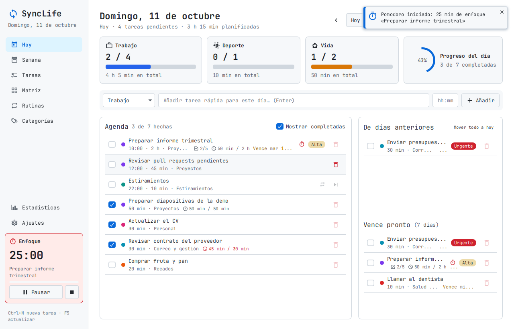
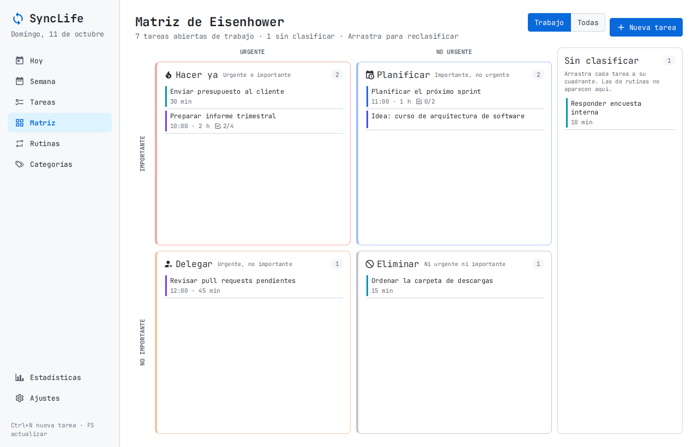
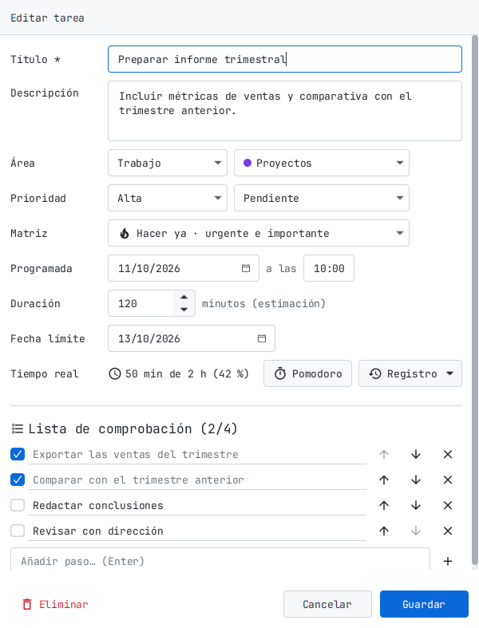
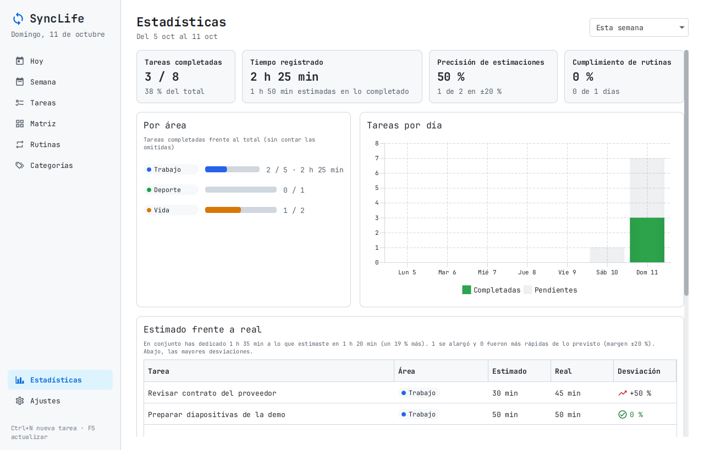
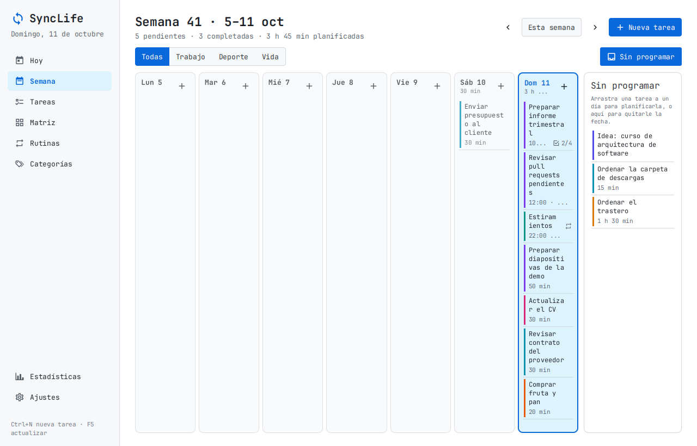
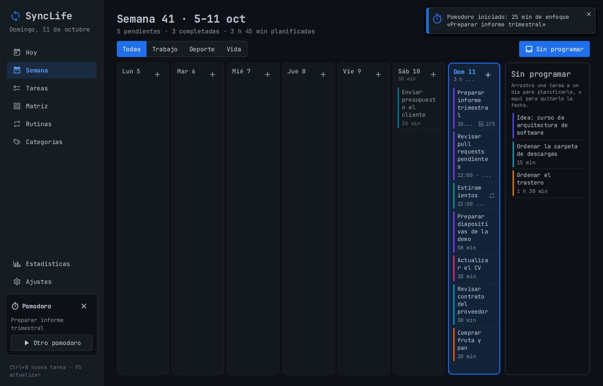

# SyncLife

Gestor de tareas y rutinas de escritorio, centrado en el **trabajo** y con espacio para el **deporte** y la **vida personal**.
Hecho con **Java 21 + JavaFX 21**, persistencia en **SQLite** mediante **Hibernate 7**, y distribuido como **un único JAR ejecutable** (Windows y Linux).

## Ejecutar

Requisitos: un JDK/JRE **21 o superior** (funciona también con Java 25).

```bash
# Compilar, pasar los tests y generar el JAR ejecutable
./mvnw clean package          # en Windows: mvnw.cmd clean package

# Ejecutar
java -jar target/SyncLife-all.jar
```

En IntelliJ: ejecuta la clase `com.alejandro.synclife.Launcher` (no `SyncLifeApp`).

Los datos se guardan en `~/.synclife/` (en Windows `C:\Users\<usuario>\.synclife\`):
`synclife.db` (SQLite), `settings.properties` y `logs/`. Se puede cambiar con `-Dsynclife.home=/otra/ruta`
o la variable de entorno `SYNCLIFE_HOME`.

> En **Ajustes → Cargar datos de ejemplo** tienes tareas y rutinas de muestra para probarla.

| Hoy (con un Pomodoro en marcha) | Matriz de Eisenhower |
|---|---|
|  |  |
| **Editor con lista de comprobación** | **Estadísticas: estimado frente a real** |
|  |  |
| **Semana** | **Tema oscuro** |
|  |  |

## Pantallas

| Pantalla | Para qué sirve |
|---|---|
| **Hoy** | Agenda del día ordenada por hora, progreso por área, alta rápida, tareas arrastradas de días anteriores y fechas límite próximas. |
| **Semana** | Siete columnas (L–D). Arrastra tareas entre días o desde "Sin programar" para planificar. Filtro por área. |
| **Tareas** | Todas las tareas en una tabla con búsqueda (sin distinguir tildes) y filtros por área, categoría, estado, prioridad y fecha. Columna **Tiempo** con lo estimado y lo real. Selección múltiple (Ctrl/Mayús + clic) para **eliminar varias a la vez** y botón **Borrar completadas**. |
| **Matriz** | **Matriz de Eisenhower**: las tareas abiertas en cuatro cuadrantes (hacer ya, planificar, delegar, eliminar) según sean urgentes y/o importantes. Arrastra entre cuadrantes para reclasificar; las nuevas esperan en "Sin clasificar". Por defecto muestra el trabajo. |
| **Rutinas** | Hábitos recurrentes (p. ej. "Gimnasio L-X-V 19:00"). Cada rutina genera automáticamente la tarea de cada día. |
| **Categorías** | Categorías propias dentro de cada área (Trabajo, Deporte, Vida), con color. Se pueden archivar. |
| **Estadísticas** | Completadas por área y por día, **tiempo real registrado**, **precisión de las estimaciones** (tabla "estimado frente a real") y cumplimiento de rutinas. |
| **Ajustes** | Tema claro/oscuro, días de antelación de las rutinas, duración del Pomodoro, copia de seguridad y carpeta de datos. |

Atajos: **Ctrl+N** nueva tarea · **Ctrl+1** Hoy · **Ctrl+2** Semana · **Ctrl+3** Tareas · **Ctrl+4** Matriz · **Ctrl+6** Rutinas · **Ctrl+7** Categorías · **Ctrl+9** Estadísticas · **Ctrl+0** Ajustes · **F5** actualizar · **Supr** eliminar la tarea seleccionada · doble clic para editar · clic derecho para más acciones.
(Ctrl+5 y Ctrl+8 quedan reservados para Objetivos y Revisión semanal.)

### Lista de comprobación

En el editor de una tarea, **Lista de comprobación**: escribe un paso y pulsa Enter. Cada paso se marca, se edita,
se reordena (flechas o Alt+↑/↓) y se quita. Las listas muestran el avance (☑ 2/5). Se guarda con la tarea.

### Pomodoro y tiempo real

Clic derecho sobre una tarea → **Iniciar pomodoro** (o el botón *Pomodoro* del editor). La tarjeta de la barra lateral
muestra la cuenta atrás (también en el título de la ventana) y permite pausar, terminar o saltar el descanso.
Cada enfoque terminado se guarda como **tiempo real** de la tarea; si lo terminas antes, se guarda lo hecho (desde 1 minuto).
También puedes **apuntar tiempo a mano** desde *Registro* en el editor. Las listas muestran un reloj con
"50 min / 1 h" (en rojo si te pasas más de un 10 % de lo estimado) y Estadísticas compara lo estimado con lo real.
Duraciones (25/5/15 min, descanso largo cada 4) y sonido se cambian en Ajustes.

### Matriz de Eisenhower

Cada tarea puede marcarse como **urgente** y/o **importante**, independientemente de su prioridad, desde la Matriz
(arrastrando), el editor (campo *Matriz*) o el clic derecho → *Matriz*. Las tareas generadas por rutinas no se clasifican.

Para **eliminar** una tarea: la papelera al final de cada fila, el botón «Eliminar» del editor o la tecla Supr.
Las tareas que genera una rutina no se eliminan (volverían a aparecer): en su lugar se **omiten** (icono ⏭ o Supr).

## Arquitectura (MVC por capas)

```
src/main/java/com/alejandro/synclife/
├── Launcher.java            punto de entrada del JAR (no extiende Application)
├── SyncLifeApp.java         aplicación JavaFX
├── AppContext.java          raíz de composición: crea Hibernate, DAOs y servicios
├── config/                  rutas de datos, ajustes de usuario, logging
├── persistence/             HibernateUtil, migraciones Flyway, copia de seguridad, converters
├── model/                   MODELO: entidades JPA (Task, Category, Routine, Subtask, TimeEntry) y enums
├── dao/                     consultas HQL (reciben la Session; sin estado)
├── service/                 lógica de negocio y transacciones
├── controller/              CONTROLADORES: uno por vista FXML
└── ui/                      navegación, celdas, controles propios, Pomodoro, avisos, hilo de BD (FxAsync)
src/main/resources/
├── hibernate.cfg.xml
├── db/migration/            esquema SQL versionado (Flyway)
└── com/alejandro/synclife/  VISTAS: view/*.fxml, css/app.css, images/
```

- **Vista** (FXML + CSS) → **Controlador** (solo llama a servicios) → **Servicio** (transacción) → **DAO** (HQL) → SQLite.
- Todo el acceso a la base de datos se hace en **un único hilo** (`ui/FxAsync`), fuera del hilo de JavaFX: la interfaz no se bloquea y SQLite nunca recibe dos escrituras a la vez.

### Modelo de datos

- **Area** (enum fijo): `TRABAJO`, `DEPORTE`, `VIDA`.
- **Category**: nombre, color y área. Personalizable. Se puede archivar.
- **Task**: título, descripción, área, categoría (opcional), estado, prioridad, día programado, hora, duración estimada, fecha límite, fecha de completado y marcas **urgente/importante** (vacías = sin clasificar). Si la generó una rutina, apunta a ella.
- **Subtask**: un paso de la lista de comprobación de una tarea (texto, hecho, orden).
- **TimeEntry**: tiempo real dedicado a una tarea (inicio, fin, minutos efectivos y origen: Pomodoro o manual).
- **Routine**: nombre, área, categoría, días de la semana (máscara de bits), hora, duración, prioridad, vigencia (desde/hasta) y si está activa.

Subtareas y registros de tiempo se borran con su tarea (`ON DELETE CASCADE`). Para no cargar listas enteras en la
interfaz, la tarea trae calculados (`@Formula`) cuántos pasos tiene, cuántos están hechos y los minutos registrados.

Las **rutinas generan sus tareas** desde hoy hasta el horizonte configurado (14 días por defecto), nunca para días pasados y sin duplicados.
Una tarea de rutina no se borra ni se cambia de día: se puede **"Omitir"**. Al editar una rutina se regeneran sus tareas pendientes y se conservan las completadas, omitidas, en progreso o con tiempo registrado.

### Decisiones técnicas

- **Esquema con Flyway, no con `hbm2ddl`**: el dialecto SQLite de Hibernate no genera claves foráneas ni índices únicos compuestos, así que el esquema está en `db/migration/*.sql` y Hibernate solo lo usa (`hbm2ddl.auto=none`).
  Para cambiar el modelo: añade `V6__descripcion.sql` con el `ALTER TABLE` correspondiente y actualiza la entidad
  (en SQLite, una columna nueva `NOT NULL` necesita valor por defecto y una con `REFERENCES` debe admitir NULL).
- **Fechas como texto ISO** (`2026-10-12`, `19:00`) mediante `AttributeConverter`, para que no dependan de la zona horaria.
- **Sin `module-info.java`**: la aplicación se ejecuta en classpath para que el JAR único funcione sin configuración. El aviso `Unsupported JavaFX configuration: classes were loaded from 'unnamed module'` es esperado e inofensivo.
- **JAR multiplataforma**: el `pom.xml` incluye `javafx-graphics` con clasificadores `win` y `linux`. Para añadir macOS, añade también los clasificadores `mac` y `mac-aarch64`.

## Tests

```bash
./mvnw test
```

Incluye tests unitarios (días de la semana, calendario de rutinas, ciclo Pomodoro con instantes simulados, cuadrantes,
converters, formatos, ajustes) y de integración contra un SQLite real en un directorio temporal: migraciones, claves foráneas
y borrados en cascada, almacenamiento de fechas, servicios de tareas, listas de comprobación, registro de tiempo,
matriz, estadísticas, categorías y rutinas.

GitHub Actions (`.github/workflows/ci.yml`) pasa los tests en Linux con Java 21 y en Windows con Java 25, y en Linux
ejecuta también la prueba de humo de la interfaz y guarda las capturas como artefacto.

Prueba de humo de la interfaz completa (recorre todas las pantallas y guarda capturas):

```bash
java -Dsynclife.home=/tmp/synclife-prueba -Dsynclife.smoke=true -Dsynclife.smoke.shots=/tmp/capturas -jar target/SyncLife-all.jar
```

## Créditos

La interfaz usa la fuente [JetBrains Mono](https://www.jetbrains.com/lp/mono/) (la del editor de IntelliJ),
incluida en el JAR bajo la licencia SIL Open Font License 1.1 (`src/main/resources/com/alejandro/synclife/fonts/OFL.txt`).

## Ideas para próximas versiones

- Objetivos a largo plazo por área con tareas vinculadas.
- Revisión semanal guiada.
- Recordatorios y notificaciones.
- Exportar/importar CSV e instalador nativo con `jpackage`.
